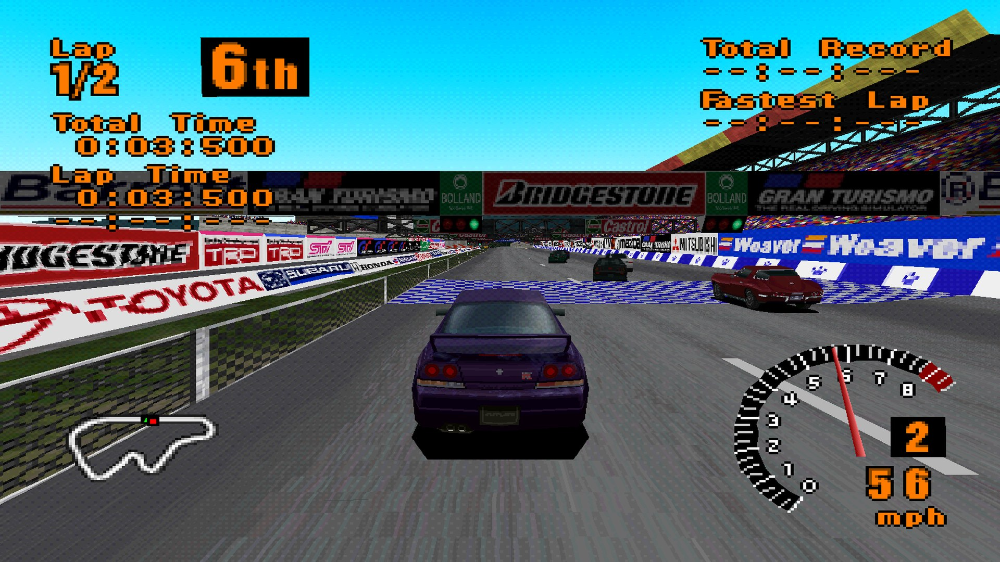

# Gran Turismo Static Recomp

A static recompilation of **Gran Turismo** (PlayStation, USA, SCUS-94194, v1.1) for Windows.
The game's original MIPS R3000A machine code is translated to C at build time and linked with
a runtime that emulates the PS1 hardware underneath it, so the game runs as a native program
rather than in an emulator.


*High Speed Ring at 4x internal resolution with sub-pixel vertices and the 16:9 mode.*

**No game code or data is included.** You need your own disc image: the build extracts the
code from it, and the game reads its data from it at run time.

This is not a decompilation and does not use decompiled source. It reuses the recompiler and
runtime of [CTR Static Recomp](https://github.com/LorenzoAlfaro/CTRStaticRecomp) (Crash Team
Racing). [`docs/RECOMP_LESSONS.md`](docs/RECOMP_LESSONS.md) records the problems hit while
building both, for anyone writing a recompiler.

## Status

* Boots through the intro movie, title screen and menus and plays races at full speed with
  music and sound effects. Tested so far: the intro, an Arcade Mode single race at High Speed
  Ring, and in Simulation Mode the GT World map, My Home, the License center and the B-1
  license test (including its result screen and retry). Buying cars, championships, the ending
  (`GTEND.EXE`), replays, two-player battle and memory card saves (`memcard1.mcd`) have not
  been tested yet.
* FMV playback (MDEC) is implemented.
* 4x internal resolution with sub-pixel vertices (no wobble) by default, optional 16:9
  widescreen, keyboard and controller support (see below).
* Not implemented: the analog-pad protocol (analog sticks are mapped to the D-pad), more than
  one controller port.
* Windows x64 only for now (`runtime/jmp.c` is Win64 assembly; everything else is portable
  C/C++ with SDL2).

## Layout

| Path | What |
|---|---|
| `tools/extract.py` | pulls GT's five executables out of the disc image and unpacks them |
| `gen/recomp.py` | the recompiler: function discovery, jump tables, MIPS → C |
| `gen/mips.py` | instruction decoder shared by the tools |
| `runtime/` | CPU glue, interpreter fallback, HLE BIOS, GTE, GPU, SPU, CD-ROM, MDEC, SIO, SDL frontend |
| `tools/disasm.py` | disassembler / cross-reference search for the unpacked executables |
| `tools/lockstep.ps1` | recompiled vs. interpreter lockstep comparison (see *Debugging*) |
| `tools/build_variant.ps1` | builds debug variants (precise timing, checks) |
| `tools/shots.sh` | headless run with periodic screenshots combined into a montage |

## How it works

* **Five programs.** GT's code is five PS-X executables that all load at 0x80010000 and replace
  each other: `SCUS_941.94` (boot), `GTOS.EXE` (intro, title, Arcade Mode), `GTMENU.EXE`
  (Simulation Mode), `GTMAIN.EXE` (races) and `GTEND.EXE`. Each is recompiled as its own
  module. A call into a function checks which program is resident by comparing its code bytes
  with RAM; the result is cached until DMA, `FlushCache` or `Exec` may have changed the code.
* **Packed executables.** Every executable is compressed (a backwards LZ with a `PSLZ` header).
  `tools/extract.py` runs the same decompression as the stub to get the code that is
  recompiled. At run time the stub itself runs on the interpreter, exactly like on the console.
* **Switching programs.** A program loads the next executable from the disc, copies it to
  0x80010000 with code running from the stack, and calls BIOS `Exec`. The HLE `Exec` discards
  every native frame of the old program and starts the new one from a top-level loop, so
  switching between menus and races does not grow the host stack.
* **Recompiled code.** Every function reachable from an entry point, `jal` targets, and code
  pointers found in data becomes a C function operating on a `CPU` struct. Jump tables become
  `switch` statements; indirect calls go through `rt_call`, which looks the target up at
  runtime.
* **Interpreter.** Anything not recompiled (the unpack stubs, code copied to the stack, the
  PsyQ exception exit) runs on a MIPS interpreter that follows exact MIPS control flow and uses
  the same cycle and event rules as the recompiled code.
* **HLE BIOS.** The BIOS functions the game uses are implemented natively, including `Exec`,
  the interrupt chain (run on a kernel stack), PsyQ's `HookEntryInt` exit, events, and memory
  cards (`memcard1.mcd`, standard 128 KiB format).
* **Hardware.** Software GPU rasterizer, GTE, SPU (ADPCM voices, ADSR, reverb, XA input),
  CD-ROM controller with XA-ADPCM, MDEC (run-length decoding, IDCT, YUV → RGB), timers, DMA,
  controller port.

## Building

Requires Python 3, CMake, Ninja and llvm-mingw (`winget install Kitware.CMake
Ninja-build.Ninja MartinStorsjo.LLVM-MinGW.UCRT`). SDL2 is downloaded by CMake.

```
.\build.ps1 -Disc "D:\path\Gran Turismo (USA).cue"
.\gt.exe
```

Run `build.ps1` from PowerShell 7 (`pwsh`). The disc path is remembered in `gt_disc.txt`; the
log is written to `gt.log`. Only the USA release (SCUS-94194) has been tried. At startup each
executable on the disc is checked against the one that was recompiled, so a build only runs
with the disc it was built from.

## Controls

Keyboard: arrows = D-pad, C = Cross, V = Circle, X = Square, Z = Triangle, Enter = Start,
Space = Select, LShift/RShift = L1/R1, LCtrl/RCtrl = L2/R2. F11 or Alt+Enter = fullscreen,
Tab = fast forward, Pause = pause, F9 = 16:9 widescreen, F10 = internal resolution
(1x/2x/4x), F8 = PGXP sub-pixel vertices, F7 = dithering. Settings are saved in `gt.cfg`.

Game controllers with an SDL mapping (Xbox/XInput, DualShock 4/DualSense, most common pads)
use the standard layout (A = Cross, B = Circle, X = Square, Y = Triangle). Joysticks without a
mapping (e.g. vJoy) use a generic layout: button 0 = Cross, 1 = Circle, 2 = Square,
3 = Triangle, 4/5 = L1/R1, 6/7 = L2/R2, 8 = Select, 9 = Start, stick/hat = D-pad.
All connected controllers are read at once (their inputs are combined). Detected devices are
listed in `gt.log`; controllers keep working when the window is not focused.

`--display N` (or `display=N` in `gt.cfg`) opens the window on monitor N; the monitors are
listed in `gt.log`.

## HD rendering

The GPU renders at 4x the native resolution by default. `--scale 1|2|4|8` or F10 changes it;
`--scale 1 --no-pgxp` gives the original output exactly.

* **Upscaled VRAM.** VRAM is kept at the internal resolution, each native pixel an NxN
  block. CPU transfers, texture and CLUT fetches use the top-left sample of each block, so the
  game sees the native 1024x512 VRAM while polygons, sprites and lines are drawn at full
  resolution (`runtime/gpu.cpp`).
* **PGXP.** The GTE rounds projected vertices to whole pixels, which is what makes PS1 geometry
  wobble. RTPS/RTPT record the exact position of every vertex they output, keyed by the rounded
  value; the GPU looks vertices up when they arrive and rasterizes with 1/256-pixel precision
  (`runtime/pgxp.cpp`). `--no-pgxp` or F8 turns it off.
* **Multithreaded.** Primitives are rendered by worker threads while the emulated CPU keeps
  running, with hazard tracking so results are identical to single-threaded rendering.
* **Dithering** uses the native 4x4 pattern scaled up; `--no-dither` or F7 turns it off.

A race runs at full speed (16.7 ms per 60 Hz field) at 4x on a Ryzen 5 3600.
`GT_PROFILE=1` logs a per-frame
breakdown every 300 frames, `GT_GPU_THREADS=N` sets the number of render threads.

## Widescreen

`--widescreen` or F9 switches to 16:9. It is done in the GTE rather than in game code: the
perspective transform (RTPS/RTPT) scales projected X by 3/4 around the screen center, so a
16:9 field of view fits in the game's 4:3 picture, which is then shown stretched to 16:9
(`runtime/gte.cpp`). 2D elements (HUD, menus, text) are not corrected and appear 33% wider.
The game still culls with its own 4:3 view, so objects near the left and right edges can
appear late.

## Debugging tools

* `--frames N`, `--shot N file.bmp`, `--shot-every N dir`, `--turbo`, `--keys` (scripted
  input, e.g. `"1600:start,2500:cross,4000:cross:600"`): headless test runs.
* `--interp`: run everything on the interpreter (reference behaviour).
* `tools/lockstep.ps1 [-Keys ...]`: builds with per-instruction cycle accounting, runs
  recompiled and interpreted execution, and reports the first frame whose RAM or cycle count
  differs. `--trace A B file` logs every function entry with cycle counts for frames A..B to
  find the exact divergence. The current build matches the interpreter cycle-for-cycle for
  5,500 frames from boot into a race.
* `--verify`: differential check of dynamic calls (native vs interpreter from same state).
* `-DRECOMP_CHECK_CALLS=ON` builds report callee-saved register clobbers and support
  `--watch-addr` / `--watch-value` store watchpoints.
* `-v`: verbose log (CD, BIOS, MDEC, SPU levels).
* Crashes print a host backtrace (`tools/symbolize.sh build/run_err.txt`) and dump RAM to
  `build/crash_ram.bin`.

## Credits

* [CTR Static Recomp](https://github.com/LorenzoAlfaro/CTRStaticRecomp): the recompiler and
  runtime this project started from.
* [psx-spx](https://psx-spx.consoledev.net/) (PlayStation hardware documentation): GTE, GPU,
  SPU, CD-ROM, MDEC and timing behaviour.
* [SDL2](https://www.libsdl.org/) for video, audio and input.
* Written by Claude (Opus 5.5, via Claude Code), directed and tested by Lorenzo Alfaro.

Gran Turismo is a trademark of its respective owners. This project is not affiliated with or
endorsed by them, and is intended for use with a legally owned copy of the game.

## License

The code in this repository is released under the [MIT License](LICENSE).
